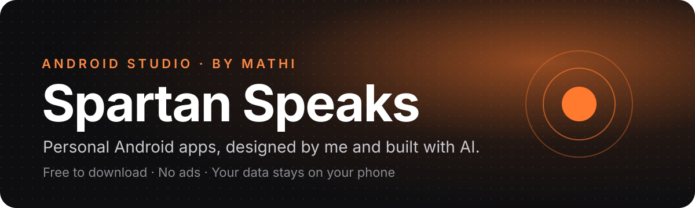
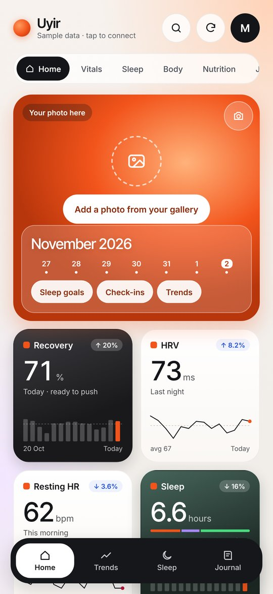
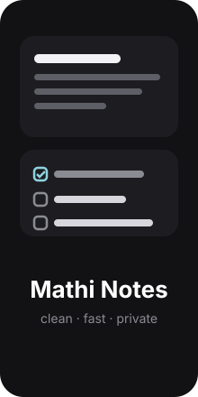
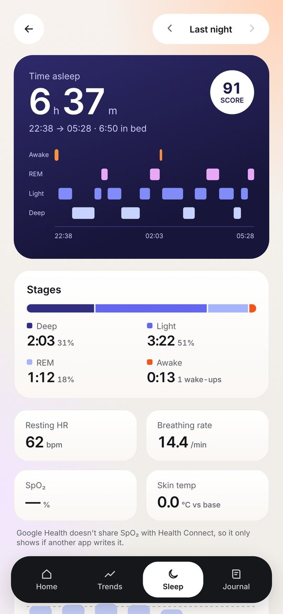
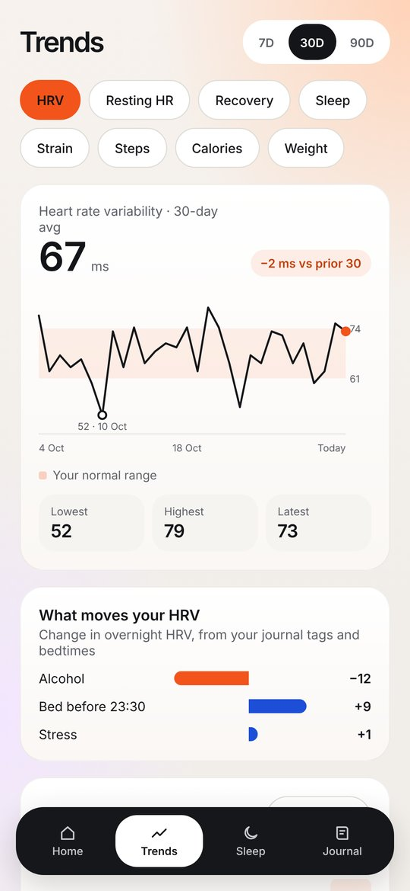
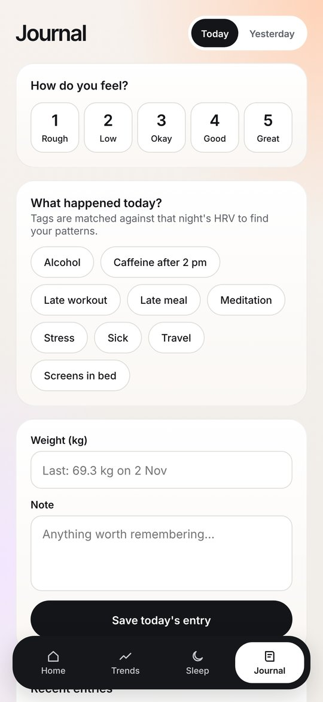

<p align="center">
  
</p>

<p align="center">
  <b>A home for the Android apps I design for my own phone and share with everyone.</b><br>
  Each one started as an idea, went through design mockups, and was built with an AI pair programmer.
</p>

<p align="center">
  <a href="#-the-apps">The apps</a> ·
  <a href="docs/INSTALL.md">How to install</a> ·
  <a href="#-how-these-apps-are-built">How they're built</a> ·
  <a href="docs/FAQ.md">FAQ</a>
</p>

---

## 📱 The apps

| | App | What it does | Download |
|:--:|---|---|:--:|
|  | **[Uyir (உயிர்)](apps/uyir/README.md)**<br><sub>Health · v1.0.49 · 10 MB · Android 9+</sub> | Your own health dashboard for the **Fitbit Air**. Recovery, sleep and strain scores, sleep stages, trends and a private journal that shows what actually moves your HRV. | [**⬇ Download APK**](https://github.com/Mathi-Spartan/Spartan-Speaks---Android-Studio/releases/download/uyir-v1.0.49/Uyir-1.0.49.apk) |
|  | **[Mathi Notes](apps/mathi-notes/README.md)**<br><sub>Productivity · v1.0 · 3.7 MB · Android 11+</sub> | A clean, fast notes app. Checklists, reminders, voice notes, and **scan a printed page straight into a note**. | [**⬇ Download APK**](https://github.com/Mathi-Spartan/Spartan-Speaks---Android-Studio/releases/download/mathi-notes-v1.0/MathiNotes-1.0.apk) |

> **New to installing apps from outside the Play Store?** It takes about a minute. Follow the [step-by-step install guide](docs/INSTALL.md).

All downloads live on the [Releases page](https://github.com/Mathi-Spartan/Spartan-Speaks---Android-Studio/releases), with release notes and a checksum for every file.

---

## ✨ A closer look

### Uyir (உயிர்), your health, your way

*Uyir* means "life" in Tamil. I bought a Fitbit Air and didn't enjoy the stock app, so I designed my own.

<p>
  
  
  
  
</p>

- **Daily scores:** Recovery, Strain and Sleep, calculated by Uyir on your phone
- **Sleep in detail:** a stage-by-stage timeline, sleep score, bedtime consistency and sleep goals
- **Trends:** HRV, resting heart rate, steps and weight over weeks
- **Journal:** tag your evenings (alcohol, late workout, screens in bed…) and Uyir shows which habits raise or lower your HRV
- **Your photo** on the home card, **CSV export**, and a **sample-data mode** so you can explore without a watch

[Full details →](apps/uyir/README.md)

### Mathi Notes, notes without the clutter

- **Notes and checklists**, pinned to the top when they matter
- **Reminders** that ring on time and survive a phone restart
- **Voice notes:** speak and it types for you
- **Scan a page:** point the camera at printed text and it becomes an editable note, read on the phone
- **Templates** for a daily journal, meeting notes, a packing list and more
- **Search, share, back up and restore**

[Full details →](apps/mathi-notes/README.md)

---

## 🤖 How these apps are built

I'm a developer, and these apps are built **with AI as my pair programmer** ([Claude](https://claude.ai) by Anthropic). The ideas, the design calls and the testing are mine. The AI helps me move from idea to working app much faster than I could alone.

Every app follows the same path:

```
💡 Idea → 🎨 Mockups → ✅ Approve → 🛠 Build → 📱 Daily use → 🚀 Release
```

1. **Idea:** a real problem from my own day (a health app I didn't like, notes that felt cluttered).
2. **Mockups:** interactive design prototypes, often several rounds, until it feels right.
3. **Approval:** nothing gets built until I'm happy with how it looks.
4. **Build:** native Android apps (Kotlin, Jetpack Compose or a WebView-based UI), compiled and signed into an APK.
5. **Real-world testing:** I use every app on my own phone before it's published here.
6. **Release:** the tested APK is published on this repo's Releases page.

---

## 🔒 Privacy promise

- **No accounts, no ads, no tracking.**
- Your notes and your health data **stay on your phone**. These apps have no servers.
- Every app's page lists exactly which permissions it asks for, and why.

---

## 🗺 What's next

More apps are on the way, and each will be added here once it has passed daily use on my own phone. Watch or star this repo to hear about new releases.

---

<p align="center">
  Designed &amp; built by <b>Mathi</b> · <a href="https://github.com/Mathi-Spartan">@Mathi-Spartan</a><br>
  <sub>Found a bug or have an idea? <a href="https://github.com/Mathi-Spartan/Spartan-Speaks---Android-Studio/issues">Open an issue</a>.</sub>
</p>
