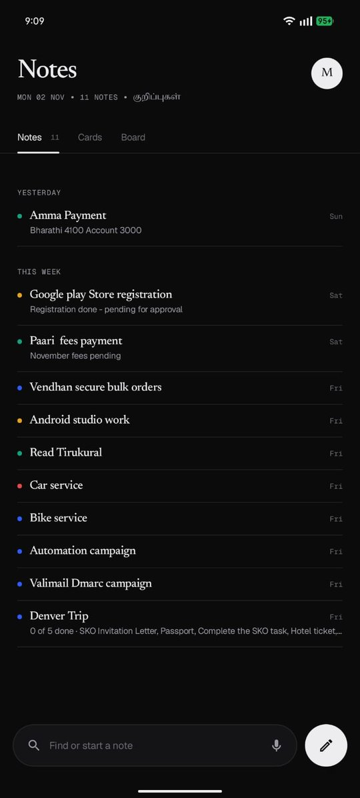
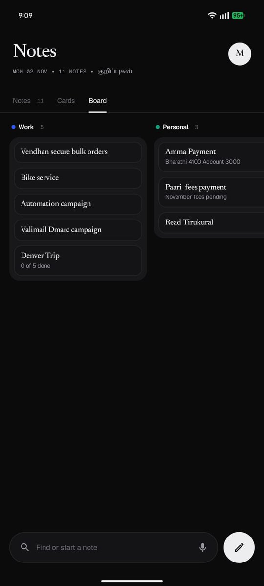
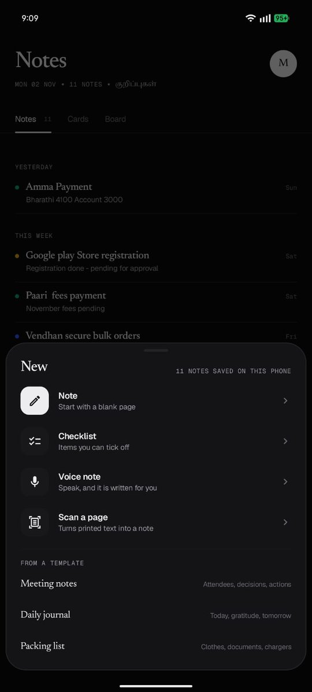
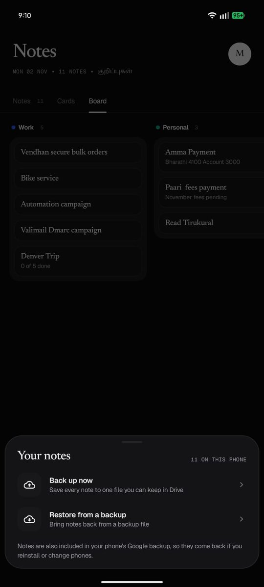

# Kurippu (குறிப்பு)

**A clean, fast notes app for Android.** Designed & built by Mathi.

*Kurippu* means "a note" in Tamil.

I wanted a notes app that opens instantly, stays out of the way and still does the useful things: reminders, checklists, voice, and turning a printed page into text.

[**⬇ Download Kurippu v1.1.1 (APK, 4.2 MB)**](https://github.com/Mathi-Spartan/Spartan-Studio/raw/main/downloads/Kurippu-1.1.1.apk) · [Install guide](../../docs/INSTALL.md) · [All downloads](../../downloads/)

  
  
  
  

List · Board · New note · Backup

> **New in 1.1:** Kurippu has been rebuilt from the ground up, with the same look and every feature, ready for Google Play. It now carries the Kurippu name and icon on your phone.

### Coming from Mathi Notes (v1.0)?
Version 1.1 is a new app ID, so it installs **next to** the old Mathi Notes instead of replacing it. To bring your notes across:
1. In **Mathi Notes**, tap **M** → **Back up now** and save the file.
2. In **Kurippu**, tap **M** → **Restore from a backup** and pick that file.
3. Check your notes are all there, then uninstall Mathi Notes.

---

## What it does

### ✍️ Write
- **Notes and checklists:** tick items off as you go, and mark them not done again
- **Pin to top** the notes that matter right now
- **Templates** to start fast: Meeting notes, Daily journal, Packing list, Ideas, Decisions, or a blank page
- **Tags** to keep notes organised (Work, Personal…)

### 👀 Three ways to see your notes
- **Notes:** a clean list grouped by Yesterday, This week and older
- **Cards:** your notes as a grid of cards
- **Board:** columns by tag, like a mini kanban board

### ⏰ Remind
- **Remind me** on any note: today, tomorrow or any time you pick
- Reminders still fire after your phone restarts

### 🎙 Speak
- **Voice notes:** tap the mic, speak, and your words are typed into the note

### 📷 Scan
- **Scan a page:** take a photo of printed text and it becomes an editable note
- Text recognition runs **on your phone** (Google ML Kit). The first scan may take a moment while Google Play services sets up the text model.

### 🔎 Find and keep
- **Search** across all your notes
- **Share** any note to another app
- **Back up** every note to one file you can keep in Google Drive, and **restore** it anytime (old Mathi Notes backups work too)
- Notes are also included in your phone's own Google backup, so they come back if you reinstall or change phones

---

## Requirements

| | |
|---|---|
| Android | 11 or newer (built for Android 16) |
| For scanning | A camera app and Google Play services |

## Permissions, and why

| Permission | Why Kurippu needs it |
|---|---|
| Notifications | To show your reminders |
| Exact alarms | So reminders ring at exactly the time you set |
| Run at startup | To put your reminders back after the phone restarts |
| Internet / network state | Used by Google's on-device text-recognition component for setup. **Your notes are never uploaded.** |

Full privacy policy: [PRIVACY.md](PRIVACY.md)

## Release details

| | |
|---|---|
| Version | 1.1.1 |
| Package | `dev.mathi.kurippu` |
| Size | 4.2 MB |
| SHA-256 | `dac133249e5a8b0b5a45c78dc5de63e781ce340ca0d92f04d98c7e10c9d5e472` |
| Built with | Kotlin + Jetpack Compose, Google ML Kit text recognition |
| Target | Android 16 (API 36), minimum Android 11 |

Earlier version

v1.0 was released as **Mathi Notes** (`com.mathi.notes`, 3.7 MB). It is replaced by 1.1, which can restore its backups.

---

Designed & built by Mathi, with AI as a pair programmer. [← Back to all apps](../../README.md)
