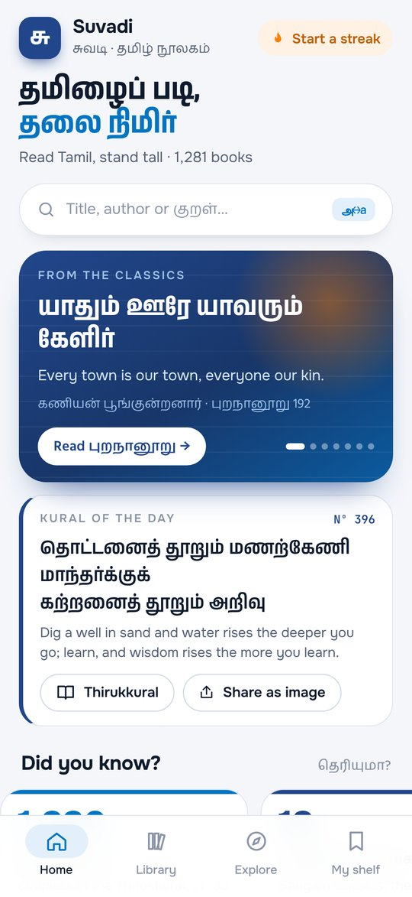
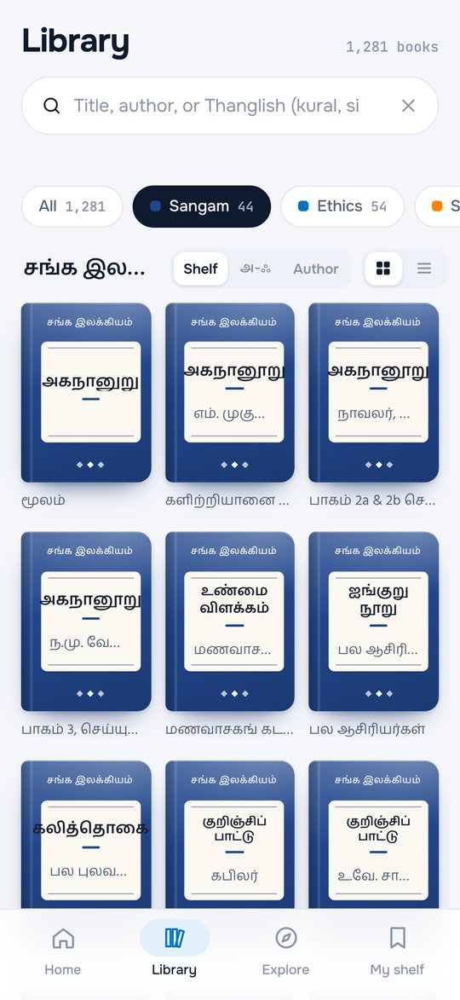
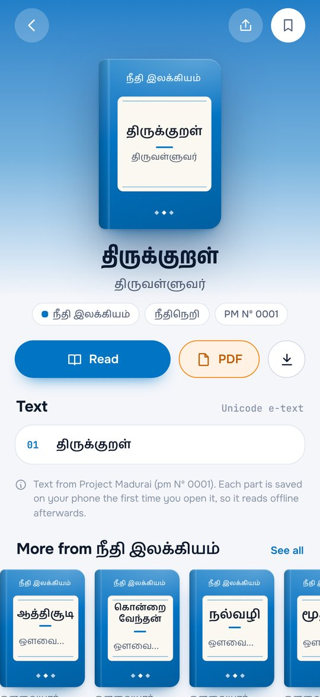
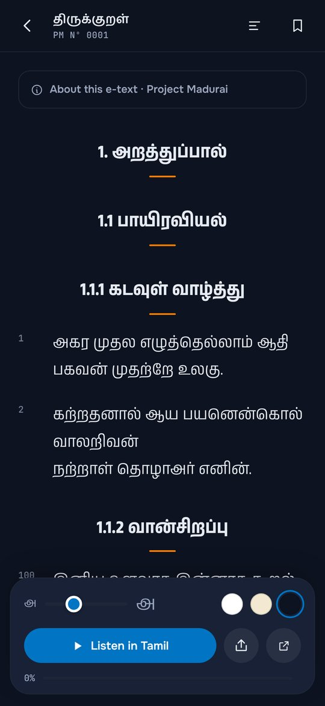
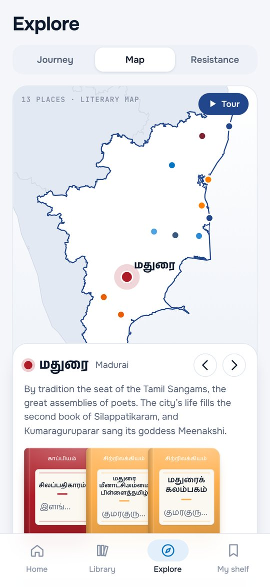
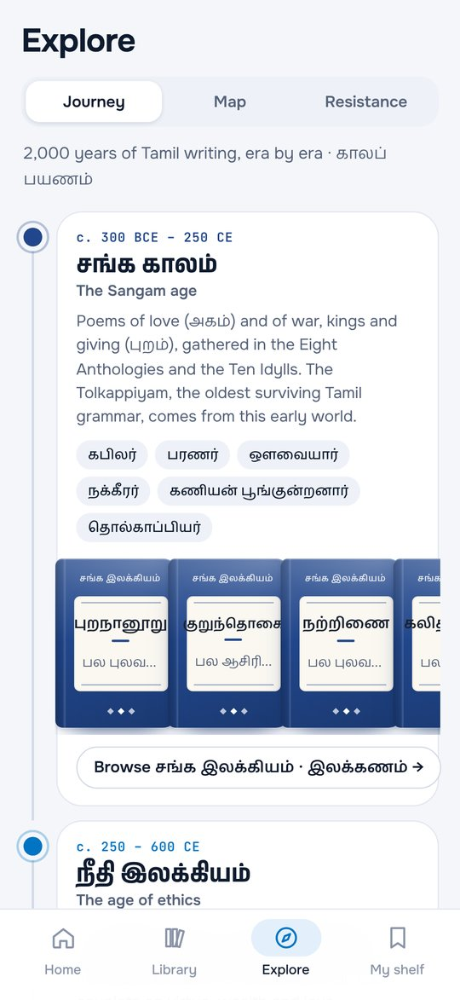
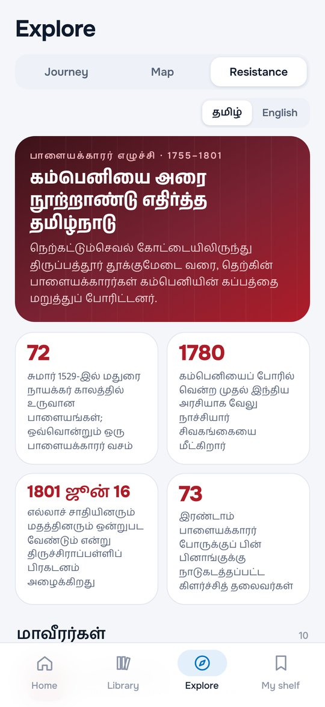
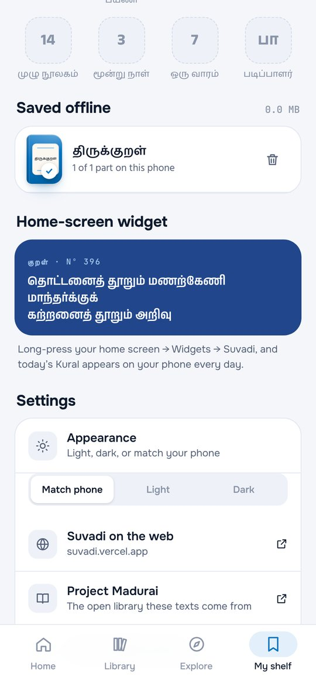

# Suvadi (சுவடி)

**A modern Tamil library in your pocket: 1,281 classic and modern Tamil books, free and offline.** Designed & built by Mathi.

*Suvadi* means a palm-leaf manuscript, the way Tamil literature was kept for two thousand years. This app brings the whole [Project Madurai](https://www.projectmadurai.org/) collection, from the Sangam poems and Thirukkural to Bharathiyar and Kalki, into one beautiful reader. It is the Android version of the [Suvadi website](https://suvadi.vercel.app).

[**⬇ Download Suvadi v1.0.50 (APK, 2.9 MB)**](https://github.com/Mathi-Spartan/Spartan-Studio/raw/main/downloads/Suvadi-1.0.50.apk) · [Install guide](../../docs/INSTALL.md) · [All downloads](../../downloads/)

  
  
  
  

  
  
  
  

---

## What it does

### 🏠 Home
- **தமிழைப் படி, தலை நிமிர்** (Read Tamil, stand tall): a rotating card of famous lines from the classics, each one opening its book
- **Continue reading** right where you stopped
- **Kural of the day**, shareable as a beautiful image
- **Did you know?** facts, **Book of the day**, and all **14 shelves** of the library

### 📚 Library
- All **1,281 books**, each with its own cover: a clean bookplate label on its section's colour
- **Search in Tamil, English or Thanglish:** type `silappathikaram` or `kural` and it finds சிலப்பதிகாரம் and திருக்குறள்
- Filter by section (Sangam, Ethics, Saiva, Vaishnava, Epics…), sort by shelf, Tamil alphabet (with a letter rail) or author, as a grid or a list

### 📖 Reader
- Books open **inside the app**, cleaned into verses and chapters, with a **contents** list
- **Day, sepia and night** themes and adjustable text size
- **Highlight**, copy, or **share any verse as an image**
- **Listen in Tamil:** reads the text aloud with your phone's Tamil voice
- Every book you open is **saved on your phone**, so it reads offline afterwards. You can also save every part of a book in one tap.

### 🗺 Explore
- **Journey through time:** seven eras of Tamil writing, from the Sangam age to today, with poets and key works
- **Literary map of Tamil Nadu:** 13 places (Madurai, Poompuhar, Chidambaram…) with a guided tour and the books tied to each
- **Palayakkarar Resistance (1755–1801):** the heroes, the timeline and full stories in Tamil and English, with recorded history and oral tradition kept apart, and sources for every story

### 🔖 My shelf
- **Reading streak**, books opened and sections explored
- **12 badges** to earn (முதல் நூல், குறள் அன்பர், காப்பியப் பயணி…)
- **My collection**, highlights, and offline books (with how much space they use)
- **Light, dark or match-your-phone** appearance

### 📱 Home-screen widget
- **Kural of the day** on your home screen: long-press the home screen → Widgets → Suvadi

---

## Requirements

| | |
|---|---|
| Android | 8.0 or newer |
| Internet | Only the first time you open a book (and for PDFs) |
| Read-aloud | A Tamil text-to-speech voice (Settings → Text-to-speech → Google → Install voice data → Tamil) |

## Permissions, and why

| Permission | Why Suvadi needs it |
|---|---|
| Internet | To fetch a book's text from Project Madurai the first time you open it |
| Vibrate | Light haptic feedback on taps |

No accounts, no ads, no tracking. Your reading history, streak, highlights and saved books stay on your phone.

## Release details

| | |
|---|---|
| Version | 1.0.50 |
| Package | `dev.mathi.suvadi` |
| Size | 2.9 MB |
| SHA-256 | `c24bd9d49acb39a5eeaab96968b04bc1ec185c602c34b163a9d6fa899b18821c` |
| Built with | Kotlin (Android shell, Tamil speech, widget) + a hand-built HTML/CSS/JS interface, with Anek Tamil, Hind Madurai and Onest fonts |

## Credits

- **Texts:** [Project Madurai](https://www.projectmadurai.org/), the open, volunteer-built library of Tamil literature. Every book stays credited to them, and the app links to their original files.
- **Map boundaries:** DataMeet India states (public data), simplified.
- **Fonts:** Anek Tamil, Hind Madurai, Onest and JetBrains Mono, under the SIL Open Font License.

---

Designed & built by Mathi, with AI as a pair programmer. [← Back to all apps](../../README.md)
