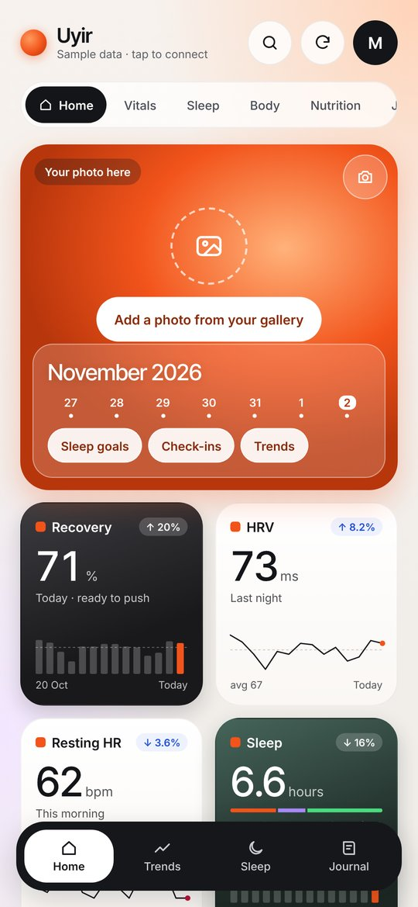
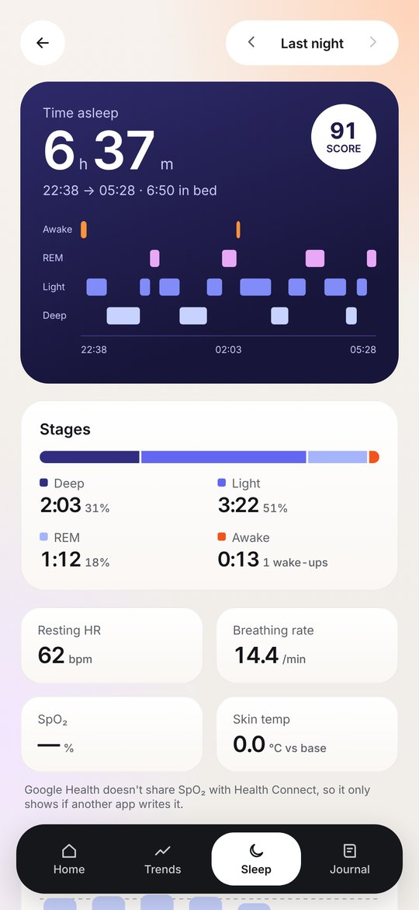
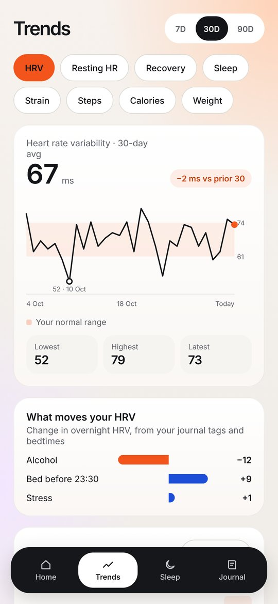
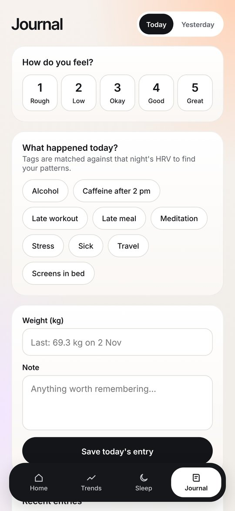

# Uyir (உயிர்)

**A personal health dashboard for the Fitbit Air.** Designed & built by Mathi.

*Uyir* means "life" in Tamil. I bought a Google Fitbit Air, didn't enjoy the stock Google Health app, and designed the dashboard I actually wanted to open every morning.

[**⬇ Download Uyir v1.0.49 (APK, 10 MB)**](https://github.com/Mathi-Spartan/Spartan-Speaks---Android-Studio/raw/main/downloads/Uyir-1.0.49.apk) · [Install guide](../../docs/INSTALL.md) · [All downloads](../../downloads/)

<p>
  
  
  
  
</p>
<sub>Screenshots use Uyir's built-in sample data.</sub>

---

## What it does

### 🏠 Home
- **Recovery, Strain and Sleep scores**, calculated by Uyir on your phone from your watch's data
- HRV, resting heart rate, steps, weight and nutrition cards, each with a mini trend
- A **photo card** you personalise with any picture from your gallery
- **Ask Uyir:** type any metric ("resting HR", "steps") and jump straight to it

### 🌙 Sleep
- A **stage-by-stage timeline** of your night (Deep, Light, REM, Awake) with a sleep score
- Time asleep against time in bed, number of wake-ups, breathing rate, skin temperature
- **Sleep goals** and **bedtime consistency**, plus a wind-down reminder

### 📈 Trends
- Weeks of HRV, resting heart rate, steps, sleep and weight, compared with **your own normal range**

### 📓 Journal
- A quick daily check-in: mood plus tags such as *alcohol*, *late workout*, *screens in bed*, *travel*, *sick*, and a note
- **"What moves your HRV":** after a few tagged nights, Uyir shows which habits raise or lower your overnight HRV

### Also
- **Export CSV** of your data
- **Sample-data mode** to explore everything without a watch

---

## How your data flows

```
Fitbit Air  →  Google Health app  →  Health Connect  →  Uyir
                                     (Android's on-phone health store)
```

Everything happens **on your phone**. Uyir has no account, no server and no analytics. It reads from Health Connect, does its calculations locally and keeps your journal on the device.

## Requirements

| | |
|---|---|
| Android | 9 or newer |
| Health Connect | Built into Android 14+. On older phones, install *Health Connect* from the Play Store. |
| Watch | Fitbit Air syncing through the Google Health app (any watch that writes to Health Connect should work too) |

## First-time setup

1. Install the APK ([how?](../../docs/INSTALL.md)).
2. Open Uyir and tap **Use my Fitbit Air**.
3. Allow the Health Connect permissions it asks for.
4. Make sure the Google Health app is sharing with Health Connect (Google Health → Settings → Health Connect).
5. Tap ↻ to sync. No watch yet? Tap **Explore with sample data**.

## Permissions, and why

| Permission | Why Uyir needs it |
|---|---|
| Health Connect: read steps, heart rate, resting HR, HRV, sleep, SpO₂, breathing rate, skin temperature, exercise, calories, nutrition, weight, history | To show your dashboard and calculate your scores |
| Health Connect: write weight | So you can log your weight from inside Uyir |
| Set alarm | For the optional wind-down / bedtime reminder |
| Internet | Only so the app can load its own built-in screens. **No data leaves your phone.** |

> **Note:** Google Health doesn't share SpO₂ with Health Connect, so that card stays empty unless another app writes it.

## Release details

| | |
|---|---|
| Version | 1.0.49 |
| Package | `dev.mathi.uyir` |
| Size | 10 MB |
| SHA-256 | `49b1c0da5c5323a57fd1fa48d47aa548e47b721358cd4de37df3bac8959d3f7e` |
| Built with | Kotlin + Health Connect SDK, with a WebView UI (HTML/CSS/JS, Inter font) |

---

<sub>Designed & built by Mathi, with AI as a pair programmer. [← Back to all apps](../../README.md)</sub>
